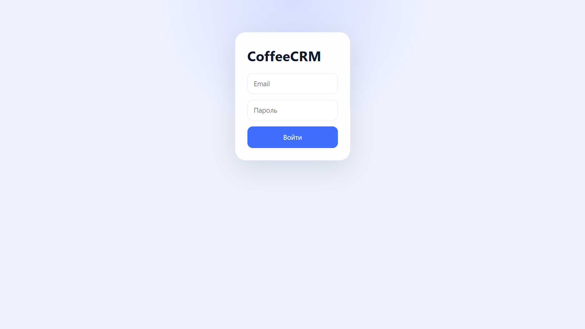
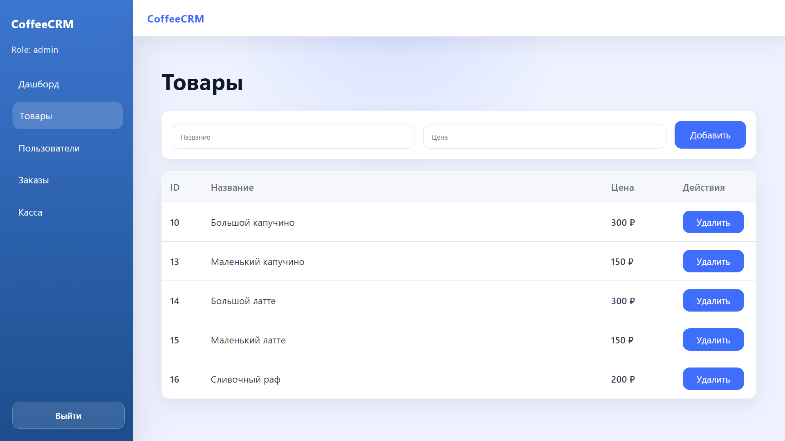
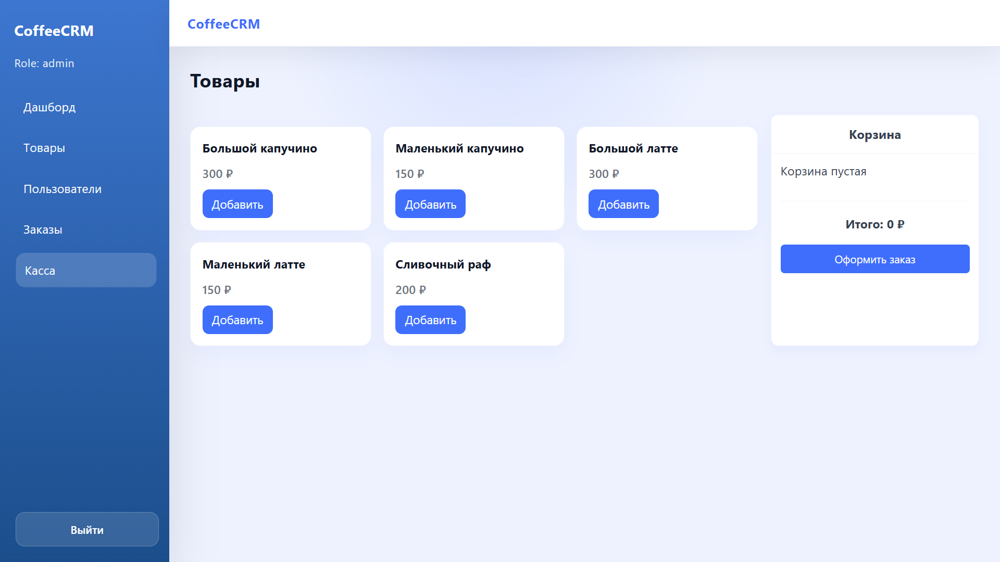
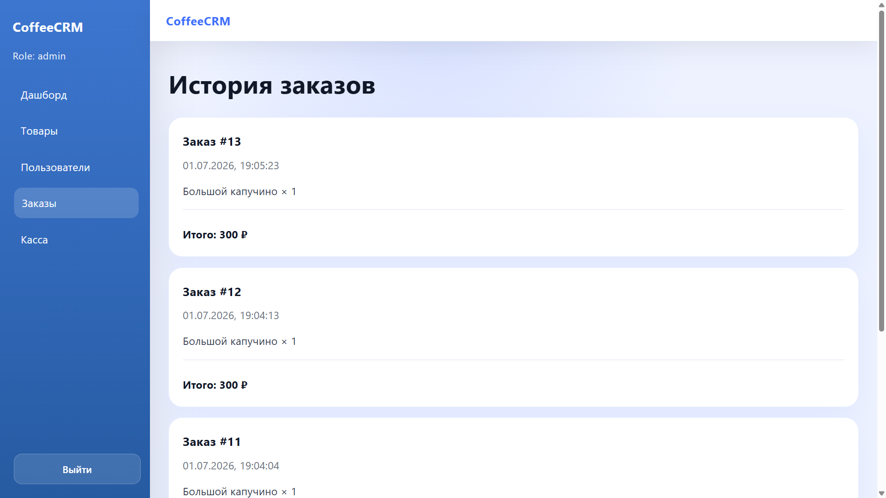
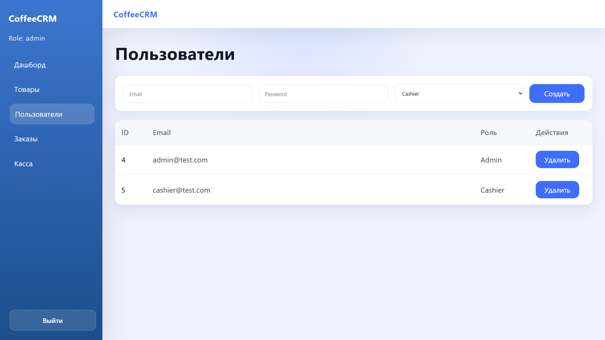
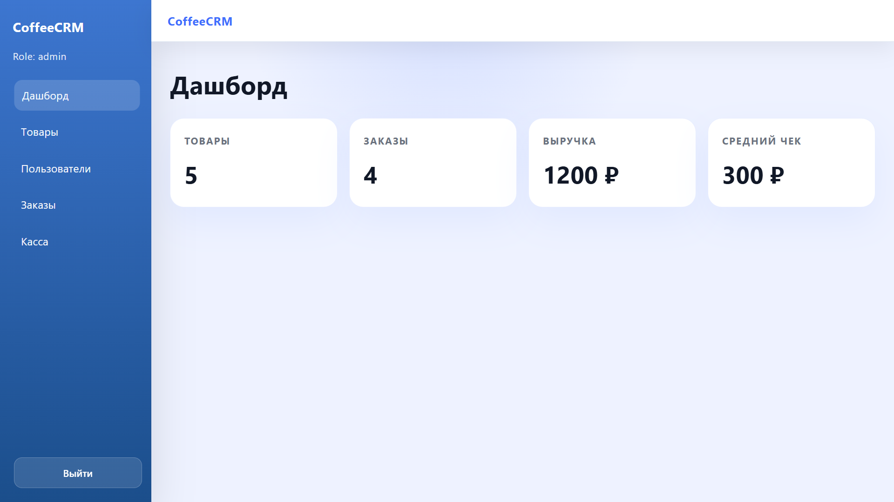

# CoffeeCRM

**Full-stack приложение для управления кофейней (POS-система)** с авторизацией, разграничением ролей, управлением товарами, пользователями и заказами.

## Содержание
- [Скриншоты](#скриншоты)
- [Возможности](#возможности)
- [Технологии](#технологии)
- [Тестовые аккаунты](#тестовые-аккаунты)
- [Установка и запуск](#установка-и-запуск)
- [Переменные окружения](#переменные-окружения)
- [Тесты](#тесты)
- [Структура проекта](#структура-проекта)
- [API](#api)
- [Роли и разрешения](#роли-и-разрешения)
- [Дальнейшие улучшения](#дальнейшие-улучшения)
- [Автор](#автор)

## Скриншоты

### Логин



### Товары



### Касса (POS)



### Заказы



### Пользователи



### Дашборд



## Возможности

- **JWT-авторизация.** Токен живёт 1 день. По истечении срока или при ответе сервера 401 пользователь автоматически выходит из системы.
- **Две роли: администратор и кассир.** Права проверяются **на сервере** для каждого запроса; в интерфейсе скрываются недоступные разделы.
- **Товары:** добавление, редактирование и снятие с продажи. Снятый товар пропадает из каталога и кассы, а история заказов остаётся целой.
- **Касса (POS):** корзина и оформление заказа. Цены и итоговая сумма считаются на сервере.
- **История заказов:** в каждой позиции сохраняются название и цена на момент продажи.
- **Пользователи:** администратор создаёт и удаляет кассиров. Публичной регистрации нет.
- **Дашборд:** количество товаров и заказов, выручка, средний чек.
- **Валидация данных** на сервере (zod) и в формах.
- **Деньги хранятся в копейках** (целые числа), без ошибок округления.

## Технологии

### Frontend
| Технология | Версия | Назначение |
|-----------|--------|-----------|
| React | 19 | UI |
| TypeScript | 6 | Типизация |
| React Router | 7 | Маршрутизация |
| Axios | 1 | HTTP-клиент |
| Vite | 8 | Сборка |
| ESLint | 10 | Линтинг |
| Vitest, Playwright | 5, 1 | Юнит- и E2E-тесты |

### Backend
| Технология | Версия | Назначение |
|-----------|--------|-----------|
| Node.js | 20+ | Runtime |
| Express | 4 | Web-фреймворк |
| TypeScript | 5 | Типизация |
| Prisma | 6 | ORM и миграции |
| PostgreSQL | 14+ | База данных |
| zod | 4 | Валидация запросов |
| jsonwebtoken, bcrypt | — | Аутентификация, хеширование паролей |
| Vitest, Supertest | 5, 7 | Интеграционные тесты API |

## Тестовые аккаунты

Данные для входа на тестовый стенд лежат в [`passwords.txt`](passwords.txt):

| Роль | Логин | Пароль |
|------|-------|--------|
| Администратор | admin@test.com | test |
| Кассир | cashier@test.com | test |

Команда `npm run seed` создаёт эти аккаунты и демо-товары в пустой базе.

## Установка и запуск

Нужны Node.js 20+ и PostgreSQL.

### 1. Клонирование

```bash
git clone https://github.com/KiraFlamov/CoffeeCRM.git
cd CoffeeCRM
```

### 2. Backend

```bash
cd CoffeeBackend
npm install                # заодно сгенерирует Prisma Client
cp .env.example .env       # заполните DATABASE_URL и JWT_SECRET

npx prisma migrate deploy  # применить миграции
npm run seed               # тестовые пользователи и товары

npm run dev                # http://localhost:3000/api
```

Продакшен-сборка:

```bash
npm run build
npm start
```

### 3. Frontend

```bash
cd CoffeeFrontend
npm install
cp .env.example .env       # при необходимости поменяйте адрес API
npm run dev                # http://localhost:5173
```

Продакшен-сборка: `npm run build`. Готовые файлы появятся в `dist/`.

## Переменные окружения

### Backend (`CoffeeBackend/.env`)

| Переменная | Обязательна | Описание |
|-----------|:-----------:|---------|
| `DATABASE_URL` | да | Строка подключения к PostgreSQL |
| `JWT_SECRET` | да | Секрет для подписи токенов |
| `JWT_EXPIRES_IN` | нет | Срок жизни токена, по умолчанию `1d` |
| `PORT` | нет | Порт сервера, по умолчанию `3000` |
| `CLIENT_ORIGIN` | нет | Адрес фронтенда для CORS, по умолчанию `http://localhost:5173`; несколько адресов — через запятую |
| `SEED_ADMIN_EMAIL`, `SEED_ADMIN_PASSWORD`, `SEED_CASHIER_EMAIL`, `SEED_CASHIER_PASSWORD` | нет | Аккаунты для `npm run seed`, по умолчанию из `passwords.txt` |

Если обязательная переменная не задана, сервер не запустится и напишет, какой именно не хватает.

### Frontend (`CoffeeFrontend/.env`)

| Переменная | Описание |
|-----------|---------|
| `VITE_API_URL` | Адрес API, по умолчанию `http://localhost:3000/api` |

## Тесты

Тесты не трогают рабочую базу: они создают рядом отдельные базы с суффиксом `_test` и `_e2e` (например, `CoffeeCRM_test` для `DATABASE_URL=.../CoffeeCRM`), сами применяют миграции и очищают таблицы. Нужен только запущенный PostgreSQL и заполненный `CoffeeBackend/.env`. Адреса баз можно задать явно через `TEST_DATABASE_URL` и `E2E_DATABASE_URL`.

```bash
# Интеграционные тесты API (Vitest + Supertest)
cd CoffeeBackend
npm test

# Юнит-тесты фронтенда (Vitest)
cd CoffeeFrontend
npm test

# E2E (Playwright): сам поднимет бэкенд на :3001 и фронтенд на :5174
cd CoffeeFrontend
npx playwright install chromium   # один раз
npm run test:e2e
```

Что проверяется:

- **API**: доступ (401 без токена, 403 для кассира на админских маршрутах, удалённый пользователь сразу теряет доступ), вход (одинаковая ошибка для неверного email и пароля), заказы (сумма по ценам из БД, объединение позиций, валидация количества, снятые с продажи товары), неизменность истории заказов после смены цены и снятия товара, ограничения на удаление пользователей, 409 на повторный email, расчёт выручки и среднего чека;
- **фронтенд**: `formatMoney`, `rublesToKopecks`, `kopecksToRubles` и `homePath`;
- **E2E**: кассир оформляет заказ и видит его в истории, кассира с `/dashboard` перенаправляет на кассу, неверный пароль показывает ошибку.

## Структура проекта

```
CoffeeCRM/
├── CoffeeBackend/
│   ├── prisma/
│   │   ├── schema.prisma         # схема БД
│   │   ├── migrations/           # миграции
│   │   └── seed.ts               # тестовые данные
│   ├── tests/                    # интеграционные тесты API
│   └── src/
│       ├── index.ts              # точка входа
│       ├── app.ts                # сборка Express-приложения
│       ├── config.ts             # проверка переменных окружения
│       ├── routes/               # маршруты и права доступа
│       ├── controllers/          # обработчики запросов
│       ├── schemas/              # zod-схемы запросов
│       ├── middleware/           # авторизация, роли, валидация, ошибки
│       └── utils/
│
├── CoffeeFrontend/
│   ├── e2e/                      # E2E-сценарии Playwright
│   └── src/
│       ├── api/                  # запросы к API
│       ├── components/           # ProtectedRoute
│       ├── context/              # контекст авторизации
│       ├── layout/               # Layout, Sidebar, Header
│       ├── pages/                # страницы
│       ├── types/                # общие типы
│       ├── utils/                # деньги, ошибки, навигация
│       └── style/                # CSS
│
├── screenshots/
├── passwords.txt                 # тестовые аккаунты стенда
└── README.md
```

## API

Все маршруты начинаются с `/api`. Кроме `/health` и `/auth/login`, для запросов нужен заголовок `Authorization: Bearer <token>`.

Суммы (`price`, `total`) передаются **в копейках**: 300 ₽ — это `30000`.

### Служебное
| Метод | Путь | Доступ | Описание |
|-------|------|--------|---------|
| GET | `/api/health` | все | Проверка работы сервера |

### Аутентификация
| Метод | Путь | Доступ | Описание |
|-------|------|--------|---------|
| POST | `/api/auth/login` | все | Вход: `{ email, password }` → `{ token, user }` |
| GET | `/api/auth/me` | авторизованные | Текущий пользователь |

### Товары
| Метод | Путь | Доступ | Описание |
|-------|------|--------|---------|
| GET | `/api/products` | авторизованные | Товары в продаже |
| GET | `/api/products/:id` | авторизованные | Один товар |
| POST | `/api/products` | admin | Создать: `{ name, price }` |
| PUT | `/api/products/:id` | admin | Изменить название и/или цену |
| DELETE | `/api/products/:id` | admin | Снять с продажи (мягкое удаление) |

### Заказы
| Метод | Путь | Доступ | Описание |
|-------|------|--------|---------|
| GET | `/api/orders` | авторизованные | История заказов, новые сверху |
| GET | `/api/orders/:id` | авторизованные | Один заказ |
| POST | `/api/orders` | авторизованные | Создать: `{ items: [{ productId, quantity }] }` |

### Пользователи
| Метод | Путь | Доступ | Описание |
|-------|------|--------|---------|
| GET | `/api/users` | admin | Список пользователей |
| POST | `/api/users` | admin | Создать: `{ email, password, role }` |
| DELETE | `/api/users/:id` | admin | Удалить (администраторов и себя удалить нельзя) |

### Дашборд
| Метод | Путь | Доступ | Описание |
|-------|------|--------|---------|
| GET | `/api/dashboard` | admin | Товары, заказы, выручка, средний чек |

Ошибки возвращаются в формате `{ "message": "..." }`. Для ошибок валидации дополнительно приходит `errors` со списком полей. Коды ответов:

- `400` — некорректные данные;
- `401` — нет токена или он недействителен;
- `403` — недостаточно прав;
- `404` — запись не найдена;
- `409` — конфликт, например такой email уже занят.

## Роли и разрешения

| Функция | Администратор | Кассир |
|---------|:-------------:|:------:|
| Вход в систему | ✅ | ✅ |
| Касса: просмотр товаров и оформление заказов | ✅ | ✅ |
| Просмотр истории заказов | ✅ | ✅ |
| Управление товарами | ✅ | ❌ |
| Управление пользователями | ✅ | ❌ |
| Дашборд | ✅ | ❌ |

## Дальнейшие улучшения

- [ ] Поиск товаров
- [ ] Пагинация списков товаров и заказов
- [ ] Фильтрация и аналитика продаж (по дате, сумме, кассиру)
- [x] Автотесты: API, юнит-тесты фронтенда, E2E
- [ ] Refresh-токены
- [ ] Docker-контейнеризация
- [ ] CI/CD (GitHub Actions)

## Автор

Учебный full-stack pet-проект, сделан для демонстрации навыков разработки на React и Node.js.
